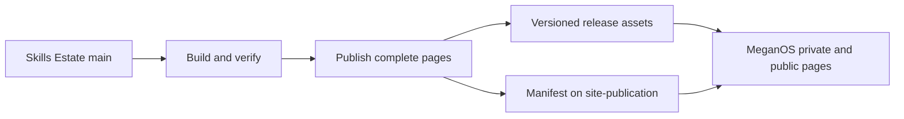

# Skills Estate site

`build.py` builds the Skills Estate website as one self-contained `index.html` in the LiveLaughCode brand. It reads the catalog from `artifacts/skills-map/index.json` and `artifacts/skills-map/workflows.json`, and it applies `config/skills-publication.json` when given `--target`.

```sh
python3 artifacts/skills-site/build.py --target estate --out .local/skills-site/index.html
```

The builder stops with a catalog drift error when `index.json` and the `skills/` folder list different skills. Rebuild the map first in that case.

## What the page shows

The page opens on an overview of the families. Its Skills, Workflows and Plugins pages each have a search field and filters. The fact cards above each list filter it by kind of skill, scoped to the open family. Opening a row shows its command, example request and connections directly beneath it. Pages link as `#skill-<id>`, `#workflow-<id>`, `#plugin-<id>` and `#family-<id>`, and older `#skill-` and `#workflow-` links still open.

## Files

- `app.js` mounts the page from the LiveLaughCode components in `vendor/bundle.js`.
- `page.css` lays those components out using design-system tokens.
- `icons.json` holds the sidebar and family icons, copied from the design system's Icons group, and which icon goes with which family.
- `vendor/` holds the design system's stylesheets and script, the Instrument Sans fonts with their license, and React 18 with its license.

The Engrace font for the wordmark is licensed for web embedding and is not committed. CI writes it from the `LLC_ENGRACE_WOFF2_BASE64` repository secret before building. A local build uses `vendor/Engrace-ItalicVF.woff2` when that file is present; without it the wordmark falls back to an installed Engrace.

## Publishing to MeganOS

The main verification workflow builds three complete pages: the estate export and the private and public MeganOS maps. `build_release.py` creates the MeganOS pair, their matching catalog and a manifest with file sizes and SHA-256 hashes. The public page applies the portfolio publication target before serialization and omits private commands, setup and repository actions.



After verification succeeds on main, the publication job downloads the artifact from that exact workflow run. `artifacts/skills-site/publish.py` uploads the complete pages and catalog as release assets, verifies their downloaded bytes, then publishes their manifest in one Git commit on the generated `site-publication` branch. It refuses a rollback or diverged source history. An identical retry leaves the branch unchanged. Publication does not write to main and does not change installed skills.

MeganOS checks that branch once a minute and reads its manifest at an immutable commit. The manifest pins the versioned release assets by their hashes. Generated HTML contains licensed embedded font data, so only the manifest is committed to Git. Page releases are prereleases named `skills-site-<source commit>` and do not replace the latest plugin release. It verifies every file's hash, source and audience before saving the pair. A failed build or download keeps the previous complete release. An open map checks for a changed version once a minute and refreshes only when the version changes. MeganOS's public publication switch and the portfolio visibility and download settings still apply.

The generated branch is for machine publication. Change layout, styles, scripts, fonts and catalog sources on main. No manual HTML copy, separate MeganOS layout deployment or running Mac is needed for those changes.

The open-page update must replace the embedded document, including when its address already has a skill or workflow hash. Keep that selected detail after the new document loads. A catalog refresh or a parent-page refresh alone does not satisfy this contract.

The `skills-estate-site` workflow artifact remains the standalone estate export. The `meganos-skills-site` artifact contains the complete pair used for publication.
