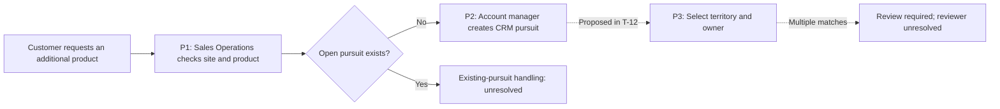

# Output model and worked example

Use this model for a full process map. Combine or omit tables when a narrower request is clearer without them. Preserve the distinctions between a business process, a record, and a system.

## Business explanation and process inventory

Open with the customer outcome and the process being mapped. Explain the customer entities and the scope boundary before introducing CRM terminology.

| Process | Customer or product scope | Start event and entry condition | Completion outcome | Related process | Evidence |
|---|---|---|---|---|---|
| Source-supported name | What business unit is affected | What happens and what must already be true | Observable business result | Input or receiving process | Exact locator |

## Step detail

| Step | Trigger or decision | Action and performer | Accountable role | Record and system | Output and receiving role | Exception | Evidence and state |
|---|---|---|---|---|---|---|---|
| Stable ID | Event plus condition | Verb plus supported role | Named role or unresolved | Grain, fact changed, and authoritative system | Handoff and acceptance condition | Supported rule or question | Locator; current, requirement, or proposal |

Keep long decision rules in a short note keyed to the step. Split wide tables by process rather than shrinking text until it is unreadable.

## Ownership and systems

Use an ownership table when several roles or records would otherwise appear to have the same owner. Include object or task, assignment input, assignment rule, responsible role, override or reassignment behavior, and source.

Use a systems table when information crosses applications:

| Fact or record | Authoritative system | Maintainer | Downstream use | Transfer event or timing | Conflict or failure handling | Evidence |
|---|---|---|---|---|---|---|
| Entity and grain | Name or unresolved | Supported role | Destination and purpose | Manual, event-driven, scheduled, or unresolved | Documented rule or open decision | Exact locator |

## Decisions needed

| Unresolved question | Affected path and consequence | Evidence or conflict | Decision owner | Next action |
|---|---|---|---|---|
| One precise rule | The step that cannot be finalized | Competing source locators or missing evidence | Supported role, proposed reviewer, or unknown | Specific decision or example needed |

Keep proposed improvements in a separately labeled view. A current-state map can contain unresolved steps without inventing an accepted future state.

## Synthetic worked example

These fictional inputs illustrate interpretation; they are not client rules.

- S1, operating note section 2: An account manager records a request to add a product at an existing customer site. Sales Operations checks for an existing open pursuit for that site and product. If none exists, the account manager creates a pursuit in the CRM.
- S2, territory design issue T-12, status To Do: Product category selects one of the site's assigned territories. The territory's commercial role determines the proposed pursuit owner. Multiple territory matches require review. The reviewer and staffing-change behavior are unspecified.
- S3, systems register row 4: The ERP owns product codes. The CRM stores synchronized product codes and owns pursuit stage. The reporting tool reads pursuit data nightly.

The process is a product expansion at an existing site. It begins with a customer request and reaches pursuit creation after a duplicate check. The evidence does not describe a lead-conversion step, later sale completion, or onboarding.

P1 and P2 are documented operating steps from S1. P3 is proposed assignment behavior from S2; the To Do issue does not establish a running rule. The account manager creates the pursuit, but S1 does not establish who owns it afterward. ERP product authority, CRM pursuit authority, and the nightly reporting copy remain separate under S3.

The representative case is a request with no existing open pursuit. The exception case has multiple territory matches. The map leaves both the exception reviewer and reassignment behavior unresolved. If later evidence adds onboarding or renewals, extend the map at the documented handoff rather than assuming those processes already apply.
