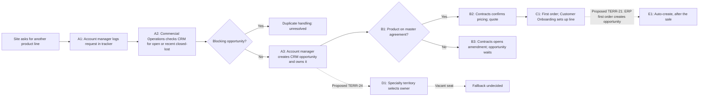

## Request

We're rolling out automatic opportunity creation and owner assignment for add-on product sales at existing hospital sites. Can you map how this works today and what's being proposed, using the attached notes, Jira export and systems register? I need to know who owns what and which questions are still open before we brief the CRM team.

## Inputs

Run of the built `map-sales-process` task package. The recording session invented this scenario, the request and the inputs below before running the skill. It had no connectors, accounts or network access and could not execute scripts, so any scripted step was done by hand and the answer says so.

#### jira-export.csv

Key,Summary,Status,Assignee,Description,Comment,Comment
TERR-21,Auto-create add-on opportunity from ERP first-order signal,To Do,Devon Reyes,"Create an opportunity when the ERP shows an order for a product line the site has not bought before.",Ana Silva: This would create opportunities after the sale. Should it be at request time instead?,Devon Reyes: Parked until TERR-24 is settled.
TERR-24,Select territory for add-on opportunity,In Progress,Devon Reyes,"Site has one geographic territory and one specialty territory per product line. Opportunity territory = specialty territory for the product line. Owner = the territory's primary rep.","Ana Silva: If the primary rep seat is vacant, fall back to the geographic territory rep?","Devon Reyes: Not decided. Sales leadership to rule."
TERR-26,Block duplicate add-on opportunities,Done,Kofi Mensah,"Duplicate check on site + product line in CRM.","Kofi Mensah: Rule added to the test sandbox 20 Oct.","Priya Anand: Not in production yet; release is not scheduled."

#### operating-note.md

#### Add-on product requests: operating note
Revision 3, 12 Sept 2026. Author: Priya Anand, Commercial Operations

##### 1. Scope
Northwind Clinical Supply sells infusion, monitoring and wound-care product lines to hospital systems. A hospital system signs a master agreement (the contracting entity). Each hospital in the system is a site that orders and uses product. This note covers a site that already buys from us and asks for an additional product line.

##### 2. Current process
1. A site's materials manager emails or calls their account manager to ask for a new product line.
2. The account manager logs the request in the shared Requests tab of the "Add-on tracker" spreadsheet (site, product line, date, requester).
3. Commercial Operations checks the CRM for an open opportunity for the same site and product line. A closed-lost opportunity less than 90 days old also blocks a new one.
4. If none exists, the account manager creates the opportunity in the CRM and owns it.
5. Pricing under the master agreement is confirmed by Contracts before a quote is issued. If the product line is not on the agreement, Contracts opens an amendment; the opportunity waits.
6. When the first order is placed, Customer Onboarding takes over setup for the new line.

##### 3. Known problems
Account managers sometimes skip step 2. Duplicates appear when two managers cover one health system.

#### systems-register.md

#### Systems register (extract)
Updated 30 Sept 2026

| Row | Fact | System | Note |
|---|---|---|---|
| 2 | Product line codes, orders, first-order date | ERP | CRM receives product line codes nightly |
| 3 | Site, contracting entity, territory assignment of site | CRM | Maintained by Sales Operations |
| 5 | Opportunity, stage, owner | CRM | |
| 6 | Master agreement terms, amendments | Contract repository | Managed by Contracts; not synced to CRM |
| 8 | Add-on request log | Add-on tracker spreadsheet | Manual entry; not synced |

## Output

I mapped add-on opportunity creation and ownership from the operating note, the Jira export and the systems register. Today the account manager creates and owns the opportunity. Territory-based owner selection is only proposed, and it conflicts with the second proposal in two places. Eight questions are open, listed at the end.

#### The business process

Northwind contracts with a hospital system under a master agreement, and each hospital is a site that orders product. A site that already buys asks for another product line. That is a product expansion at an existing site, not a lead conversion. The sources describe no new-customer path, so I did not map one.

| Process | Start | Outcome | Status |
|---|---|---|---|
| A. Add-on request to opportunity | Site asks its account manager for a new line | Opportunity in CRM, or request blocked | Current (operating note §2.1-2.4) |
| B. Pricing confirmation | Opportunity exists | Pricing confirmed, or amendment opened and opportunity waits | Current (§2.5) |
| C. Onboarding | First order placed | New line set up | Current, one line only (§2.6) |
| D. Territory and owner selection | Opportunity created | Territory and owner set by rule | Proposed, TERR-24, In Progress |
| E. Auto-create from ERP first order | ERP shows an order for a line new to the site | System creates opportunity | Proposed, TERR-21, To Do and parked |

#### Current path

Solid lines are current. Dotted lines are proposals, and none is confirmed as running.

1. **A1.** The account manager logs site, product line, date and requester in the Add-on tracker spreadsheet. Managers sometimes skip this.
2. **A2.** Commercial Operations checks the CRM by site and product line. An open opportunity blocks creation, and so does a closed-lost one under 90 days old.
3. **A3.** If nothing blocks, the account manager creates the opportunity. One opportunity represents one site and one product line. The creator owns it.
4. **B.** Contracts confirms pricing under the master agreement before a quote. If the line is not on the agreement, Contracts opens an amendment and the opportunity waits.
5. **C1.** The first order triggers Customer Onboarding.

#### Ownership

| Object | Rule | Responsible | Source |
|---|---|---|---|
| Request row | Manual entry | Account manager | Operating note §2.2 |
| Opportunity, today | Creator owns | Account manager | §2.4 |
| Opportunity, proposed | Territory = the site's specialty territory for the product line. Owner = that territory's primary rep | Territory primary rep | TERR-24 |
| Jira tickets | Work assignment only | Devon Reyes (TERR-21, TERR-24), Kofi Mensah (TERR-26) | Export |

The Jira assignees are not the business owners. The sources do not say whether the account manager and the territory primary rep are the same person.

#### Systems of record

| Fact | System | Maintainer | Transfer |
|---|---|---|---|
| Product line codes, orders, first-order date | ERP | Not stated | Codes sent to CRM nightly (register row 2) |
| Site, contracting entity, site territory | CRM | Sales Operations | n/a (row 3) |
| Opportunity, stage, owner | CRM | Account manager today | n/a (row 5) |
| Agreement terms and amendments | Contract repository | Contracts | Not synced to CRM (row 6) |
| Request log | Add-on tracker | Account managers | Manual, not synced (row 8) |

#### What the tickets do and do not establish

- **TERR-26** (duplicate block) shows Done. Priya Anand's comment says the rule is in the test sandbox only, since 20 Oct, with no production release scheduled. It is not running. Its description also leaves out the 90-day closed-lost condition from the operating note.
- **TERR-21** would create the opportunity from the ERP first-order signal. That is after the sale, while today's process creates it at request time. Ana Silva raised this in a comment and the ticket is parked behind TERR-24.
- **TERR-24** is In Progress. Its vacancy fallback is undecided, and sales leadership is to rule.

#### Decisions needed

| Question | Affects | Proposed decision owner |
|---|---|---|
| Is the opportunity created at request time (A3) or from the ERP first order (E1)? E1 would fire after A3 already created it. | A3, E1 | Commercial Operations with sales leadership |
| What happens to a blocked request, and who tells the account manager? | A2 | Unknown |
| Who owns the opportunity when the territory primary rep differs from the requesting account manager? | A3, D1 | Sales leadership |
| What is the fallback for a vacant primary seat, and how are staffing changes and multiple matches handled? | D1 | Sales leadership (named in TERR-24) |
| Does the production duplicate rule include the 90-day closed-lost block? | A2, TERR-26 release | Unknown |
| Are Commercial Operations (operating note) and Sales Operations (register row 3) the same team? | A2 owner, CRM maintainer | Unknown |
| How does Contracts learn of an opportunity, and what stage marks "waiting on amendment"? | B3 | Contracts, as a proposal |
| What does the geographic territory do beyond the TERR-24 fallback? | D1 | Unknown |

#### Walk-through

**Typical case.** A materials manager asks for the wound-care line. The account manager logs it (A1). No open or recent closed-lost opportunity exists (A2). The account manager creates and owns the opportunity (A3). The line is on the agreement, so Contracts confirms pricing (B2). The first order starts onboarding (C1).

**Exception.** The line is not on the agreement. Contracts opens an amendment and the opportunity waits (B3). What releases the wait is not documented. The vacant-seat case exists only in the proposal and is also unresolved.

#### Limits

I wrote no scripts or scanner runs. I checked the prose against the writing patterns by reading it, because the scanner was not run here. Nothing in CRM, Jira, territory rules or the source files was changed, and nothing was sent to anyone. The map is prepared locally.

#### Files

- `out/addon-process-map.md`: the full map, with the inventory, step-detail table, ownership and systems tables, the decisions table and the walk-through. The tables above are condensed from it.

### File: addon-process-map.md

#### Add-on product opportunities at existing hospital sites

##### What happens and why

Northwind Clinical Supply contracts with a hospital system under a master agreement. Each hospital in the system is a site that orders product. When a site that already buys from Northwind asks for another product line (infusion, monitoring or wound care), the request is a product expansion at an existing site. It is not a lead conversion, and the sources describe no new-customer path.

Sources used:
- S1: operating note, revision 3, 12 Sept 2026, sections 2 and 3
- S2: Jira export, TERR-21, TERR-24, TERR-26
- S3: systems register extract, 30 Sept 2026, rows 2, 3, 5, 6, 8

##### Process inventory

| Process | Scope | Start and entry condition | Completion | Related process | Evidence |
|---|---|---|---|---|---|
| A. Add-on request to opportunity (current) | One site and one product line | Site materials manager asks the account manager; site already buys | Opportunity exists in CRM, or request is blocked as a duplicate | Hands to B | S1 §2 steps 1-4 |
| B. Pricing confirmation (adjacent, current) | Contracting entity's master agreement | Opportunity exists | Pricing confirmed, or amendment opened and opportunity waits | Receives from A | S1 §2 step 5 |
| C. Onboarding (adjacent, current) | New line at the site | First order placed | Setup of the new line (not described further) | Receives from A/B | S1 §2 step 6 |
| D. Territory and owner selection (proposed) | Site and product line | Opportunity created | Opportunity territory and owner set by rule | Would run inside A | S2 TERR-24, In Progress |
| E. Auto-create from ERP first order (proposed) | Site and product line | ERP shows an order for a line the site has not bought | Opportunity created by system | Would replace or duplicate A step A4 | S2 TERR-21, To Do |

##### Diagram

Solid lines are current (S1). Dotted lines are proposals; none is confirmed as running.

##### Step detail

| Step | Trigger or decision | Action and performer | Accountable role | Record and system | Output and recipient | Exception | Evidence and state |
|---|---|---|---|---|---|---|---|
| A1 | Site request by email or call | Account manager logs site, product line, date, requester | Unresolved | One request row; Add-on tracker, manual | Row visible to Commercial Operations | Managers sometimes skip it | S1 §2.2, §3; S3 row 8; current |
| A2 | Request logged | Commercial Operations searches CRM by site and product line | Unresolved | Reads opportunities; CRM | Go or block decision to account manager | Open opportunity, or closed-lost under 90 days, blocks creation. Handling of a blocked request is undocumented | S1 §2.3; current |
| A3 | No blocking opportunity | Account manager creates the opportunity | Account manager (owner) | One opportunity per site and product line; CRM | Opportunity ready for pricing | None documented | S1 §2.4; S3 row 5; current |
| B1-B3 | Opportunity exists | Contracts checks the agreement; quotes or opens an amendment | Contracts | Agreement terms; contract repository | Priced quote, or amendment with opportunity waiting | Waiting stage and release condition undocumented | S1 §2.5; S3 row 6; current |
| C1 | First order placed | Customer Onboarding sets up the line | Customer Onboarding | First-order date; ERP | Line set up | Not described | S1 §2.6; S3 row 2; current |
| D1 | Opportunity created | Opportunity territory = the site's specialty territory for the product line; owner = that territory's primary rep | Sales leadership (rules on gaps) | Opportunity territory and owner; CRM | Owner assigned | Vacant primary seat: undecided | S2 TERR-24; proposal |
| E1 | ERP order for a line new to the site | System creates opportunity | Unresolved | Opportunity; CRM fed by ERP | Opportunity created | Fires after the order | S2 TERR-21; proposal, parked |

Note on TERR-26: the duplicate rule on site and product line is in the test sandbox since 20 Oct and is not in production, with no release scheduled (Priya Anand's comment). Its description omits the 90-day closed-lost condition from S1. The status Done reflects sandbox work only.

##### Ownership

| Object or task | Assignment input | Rule | Responsible | Override | Source |
|---|---|---|---|---|---|
| Add-on request row | Account manager's contact with site | Manual entry | Account manager | None documented | S1 §2.2 |
| Opportunity (current) | Creator | Creator owns | Account manager | None documented | S1 §2.4 |
| Opportunity (proposed) | Site's specialty territory for the line | Primary rep of that territory | Territory primary rep | Vacancy fallback undecided | TERR-24 |
| Jira tickets | Assignee Devon Reyes (TERR-21, 24), Kofi Mensah (TERR-26) | Work assignment only | Not business owners | n/a | S2 |

Account manager and territory primary rep may be different people. The sources do not say.

##### Systems of record

| Fact | Authoritative system | Maintainer | Downstream use | Timing | Conflict handling | Evidence |
|---|---|---|---|---|---|---|
| Product line codes, orders, first-order date | ERP | Unresolved | CRM codes; proposed trigger | Nightly to CRM | Unresolved | S3 row 2 |
| Site, contracting entity, site territory | CRM | Sales Operations | Territory selection | n/a | Unresolved | S3 row 3 |
| Opportunity, stage, owner | CRM | Account manager (current) | Quoting | n/a | Unresolved | S3 row 5 |
| Agreement terms and amendments | Contract repository | Contracts | Pricing | Not synced to CRM | Manual | S3 row 6 |
| Request log | Add-on tracker | Account managers | Duplicate check | Not synced | Manual | S3 row 8 |

##### Decisions needed

| Question | Affected path | Evidence | Decision owner | Next action |
|---|---|---|---|---|
| Should the opportunity be created at request time or from the ERP first order? | A3 versus E1: E1 creates it after the sale, when A3 already created it | S1 §2.4 against TERR-21 and Ana Silva's comment | Proposed: Commercial Operations with sales leadership | Choose one trigger, or define E1 as a safety net for requests that were never logged |
| What happens to a blocked request? | A2 | S1 §2.3 stops at the check | Unknown | Name who tells the account manager and who owns the existing opportunity |
| Who holds the opportunity when the territory primary rep differs from the requesting account manager? | A3 versus D1 | S1 §2.4 against TERR-24 | Sales leadership (proposed) | Rule on owner, and whether the account manager keeps credit |
| Fallback when the primary seat is vacant, and behavior on staffing change or multiple matches | D1 | TERR-24 comments | Sales leadership (named in ticket) | Written rule |
| Is the 90-day closed-lost block part of the production duplicate rule? | A2, TERR-26 release | S1 §2.3; TERR-26 description | Unknown | Confirm sandbox rule includes it |
| Are Commercial Operations and Sales Operations one team? | A2 owner, CRM maintainer | S1 versus S3 row 3 | Unknown | Confirm |
| How does Contracts learn of an opportunity, and what stage marks "waiting on amendment"? | B3 | Contract repository not synced | Contracts (proposed) | Describe the handoff |
| Role of the geographic territory in TERR-24 | D1 | Ticket mentions it only as fallback | Unknown | Confirm whether it affects access or rollup |

##### Check

Representative case: a hospital's materials manager asks for the wound-care line; the account manager logs it (A1); no open or recent closed-lost opportunity exists (A2); the account manager creates and owns it (A3); the line is on the agreement, so Contracts confirms pricing (B2); the first order starts onboarding (C1).

Exception: the line is not on the agreement, so Contracts opens an amendment and the opportunity waits (B3). Release of the wait is unresolved. A second exception, a vacant primary seat, applies only to the proposal and is unresolved.

[trimmed: the rest of this file, about 15 more words, is not shown]
